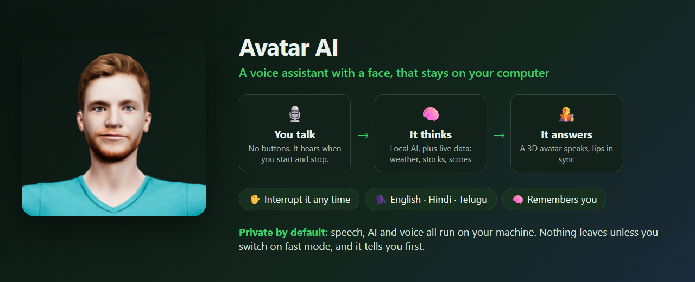

# Hi, I'm Somu 👋

**I spent 14 years finding risk in bank data: fraud, money laundering, credit losses, stress tests.**
**Now I build AI that does the heavy lifting, and keeps itself honest.**

My AI writes your resume but won't invent a single line you can't back up.
My trading terminal scores its own predictions every day and trusts the ones that have been right.
Everything here runs on its own, every morning, in the cloud. LLMs · RAG · MCP · agents.

**Builder and product owner in one:** I find the real problem, design the product, write the code, ship it to the cloud
and keep improving it from what users do. Every project below went from idea to a daily running product.

---

## 🧭 Job Search Copilot

**Find the right jobs, tailor an honest resume for each one, prepare for the interview, and track it all from your inbox.**
Runs daily on Oracle Cloud, with a Telegram bot. Built for job seekers and for staffing firms managing a whole bench.

https://github.com/user-attachments/assets/a98af491-7402-4172-9613-d2a139597a28

▶ The 2-minute pitch. More: [feature tour and full product tour](https://somu-analyst.github.io/#work).

🌐 [Website](https://somu-analyst.github.io/Job-Search-Copilot/) · 📂 [Showcase repo](https://github.com/somu-analyst/Job-Search-Copilot)

- **Finds jobs from 40+ sources:** employer career systems (Greenhouse, Lever, Ashby, Workday), job-search APIs, job boards, staffing vendors, Google Groups and Gmail job alerts, scored against each person's resume.
- **Tailors truthfully:** RAG matches every requirement to real experience, and a grounding check blocks any claim the resume can't back up.
- **Interview coach:** quizzes, mock video interviews, and AI review of a recorded interview (local speech-to-text and graded answers).
- **Tracks itself:** reads employer replies through the Gmail API and moves each application forward.
- **For staffing firms:** one job pool with a profile per consultant, plus a preview of AI talent outreach by email, SMS and voicemail.

`Python` `FastAPI` `Streamlit` `SQLite` `RAG` `sentence-transformers` `LLMs (free-model failover)` `Playwright` `Gmail API` `Telegram Bot API` `Oracle Cloud` `systemd` `GitHub Actions` `pytest`

---

## 📊 WallStreet Agentic TradeOps

**Your AI investment advisor and options trading co-pilot.** For day trades and short-term options: take the trade with data and confidence, track it, and exit with a clear plan. It turns NYSE/CBOE options-chain data into explained signals, delivered through a Telegram bot you tap like an app and a Streamlit web terminal.

- **Options toolkit:** OI build-up and short-covering detection, gamma walls (GEX), Hi-Prob (≥80%) trades, spreads, wheel/CSP, a trade risk calculator and a next-day exit planner.

▶ [Play the 2-minute video tour](https://somu-analyst.github.io/#wallstreet) · 🌐 [Website](https://somu-analyst.github.io/WallStreet_Agentic_TradeOps/) · 📂 [Showcase repo](https://github.com/somu-analyst/WallStreet_Agentic_TradeOps)

https://github.com/user-attachments/assets/d51bf120-8abd-429e-8108-1517e59483e5

- Open-interest flow, dealer gamma positioning and a 24-model signal ensemble, with Black–Scholes and Monte Carlo pricing.
- A forward-tested accuracy layer weights each model by its recent hit rate; walk-forward checks catch signals that only fit noise.
- Data from more than 15 market and macro APIs; an LLM gateway across Claude, Groq, Gemini and OpenRouter that fails over automatically; an MCP server that gives AI agents read-only access.

`Python` `Streamlit` `Telegram Bot API` `SQLite` `MCP (Python SDK)` `Docker` `LLM gateway` `Oracle Cloud` `CI/CD`

---

## 🗣️ Avatar AI

**The goal: talking to AI should feel like talking to a person, without giving away your privacy.**
You speak, it answers out loud through a lip-synced 3D avatar, and by default nothing leaves your computer.

- **Natural conversation:** no buttons; interrupt it mid-sentence and it stops and listens.
- **Live answers:** function calling fetches weather, stock prices, scores and more mid-conversation.
- **Your language:** English, Hindi or Telugu, even Telugu typed in English letters.

`Python` `FastAPI` `WebSockets` `Ollama` `faster-whisper` `function calling` `three.js (TalkingHead)`

---

## 🤗 Open source

- **Hugging Face LLM Course in Telugu:** translated Chapter 3 (fine-tuning a pretrained model) so Telugu speakers can learn LLMs in their own language. [Translation PR #1142](https://github.com/huggingface/course/pull/1142) · [translation guide PR #1152](https://github.com/huggingface/course/pull/1152) (in review)

## 🔨 Currently building

- **Talent Outreach** for consulting firms: a client requirement in, the right people found and contacted by email, SMS and voicemail.
- **"Preparing for" in Interview Prep:** pick the job you're interviewing for and every practice tab follows it.
- **Licensed job-data routes,** so the copilot depends less on any single job board.

## 🧰 Toolbox

**AI:** LLMs · RAG · embeddings · vector search · MCP · agents · prompt engineering · guardrails and evaluation
**Data:** Python · SQL · SAS · PySpark · Databricks · Snowflake · BigQuery
**Engineering:** FastAPI · Streamlit · Playwright · Docker · GitHub Actions · Oracle Cloud · Linux
**Domain:** credit risk · fraud and AML · CCAR/CECL · loss forecasting · lending analytics
